# Beam Designer v2.1 (Streamlit)

**SFD · BMD · Deflection · Serviceability · ULS load factor · Auto section · 3D · Parametric · CSV**

## What’s included

| Capability | Detail |
|------------|--------|
| Supports | Simply supported, cantilever, **overhang** |
| Loads | Point, UDL, UVL/trapezoid, point moment |
| **ULS load factor** | Strength uses factored loads; δ uses service |
| Diagrams | SFD, BMD, deflection, combined |
| **3D** | Axis + scaled δ, V–M path, I-section extrusion |
| Steel | ISMB/UB catalog, σ/τ check, utilisation |
| Auto-select | Lightest **safe** section |
| Serviceability | L/250 … L/500 |
| Parametric | UDL sweep charts |
| Export | CSV (V,M,y) + JSON summary |

## Quick start

```bash
pip install -r requirements.txt
streamlit run app_streamlit.py
pytest test_beam.py -v
```

## Diagram gallery

### Design workflow
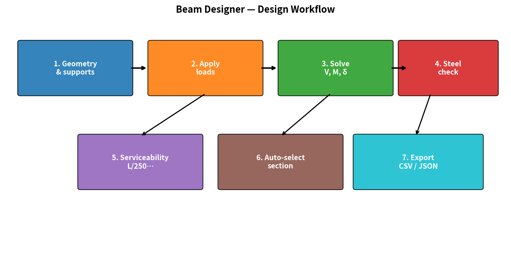

### Load case gallery (SFD & BMD)
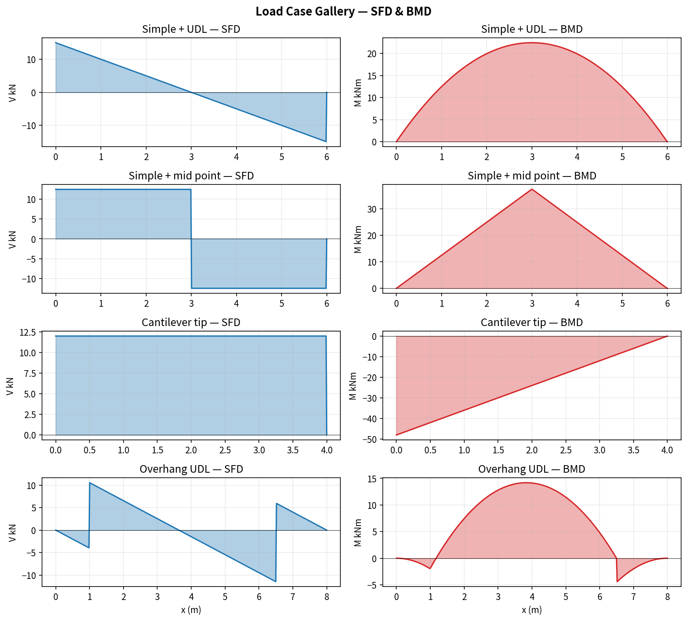

### Classic SFD / BMD / δ
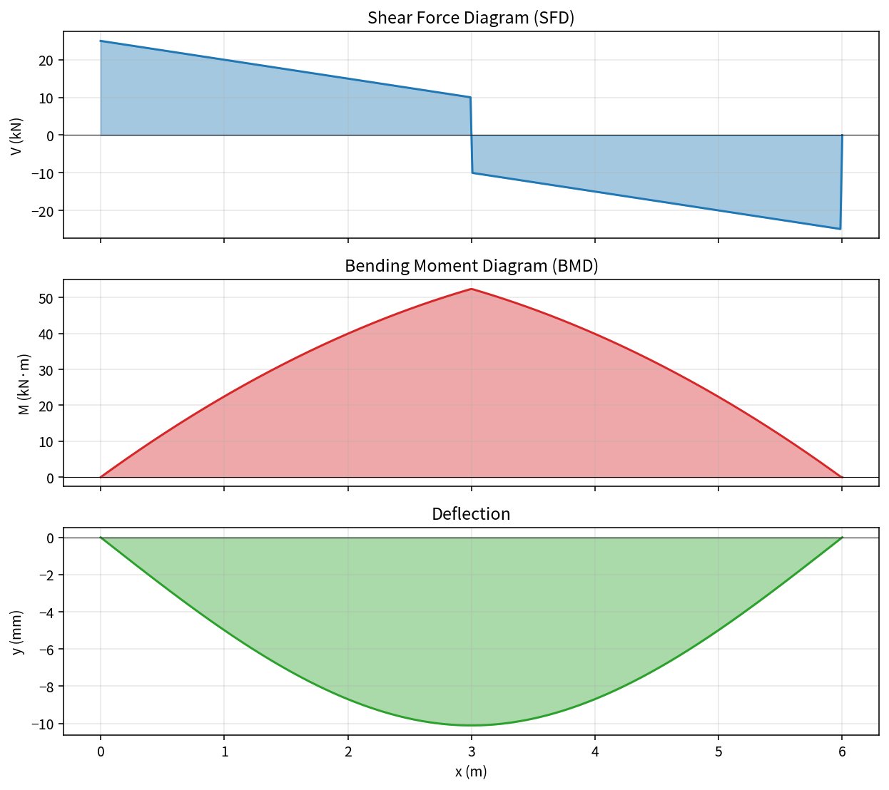

### Overhang
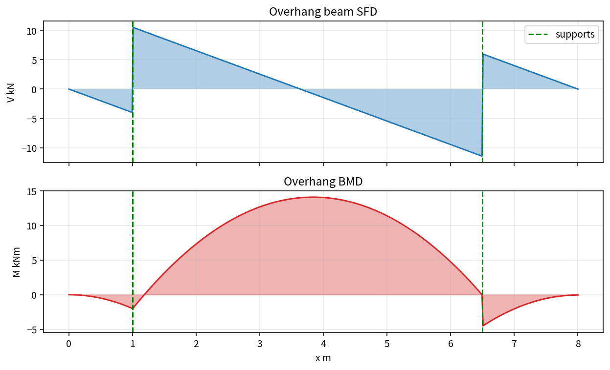

### Support-type comparison
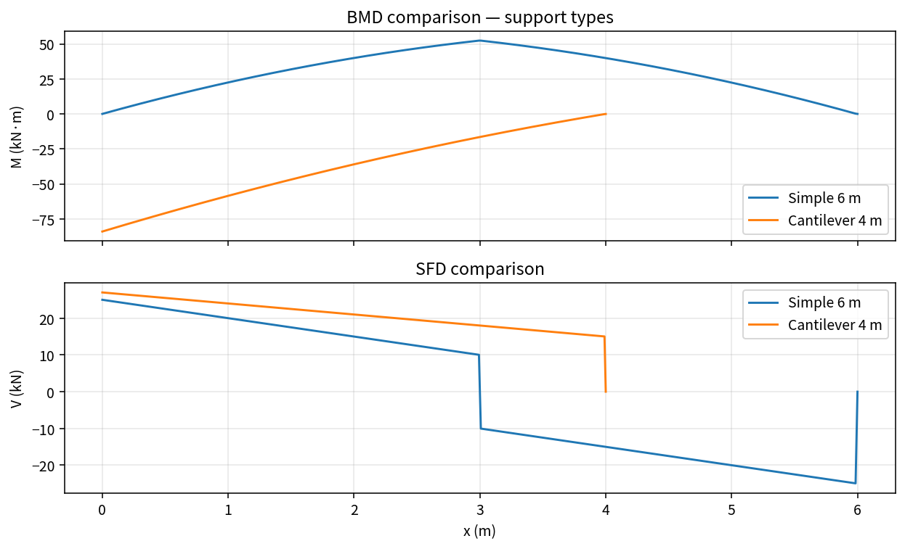

### Section comparison & utilisation
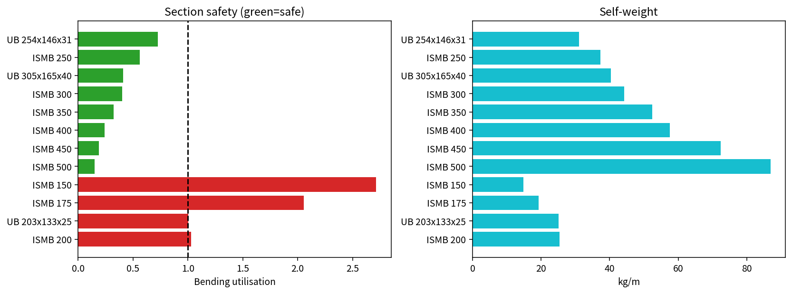
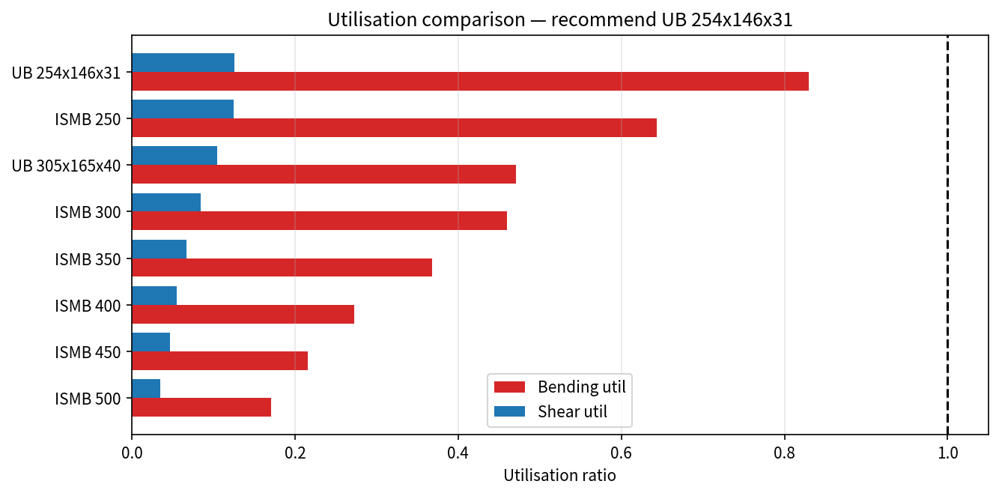
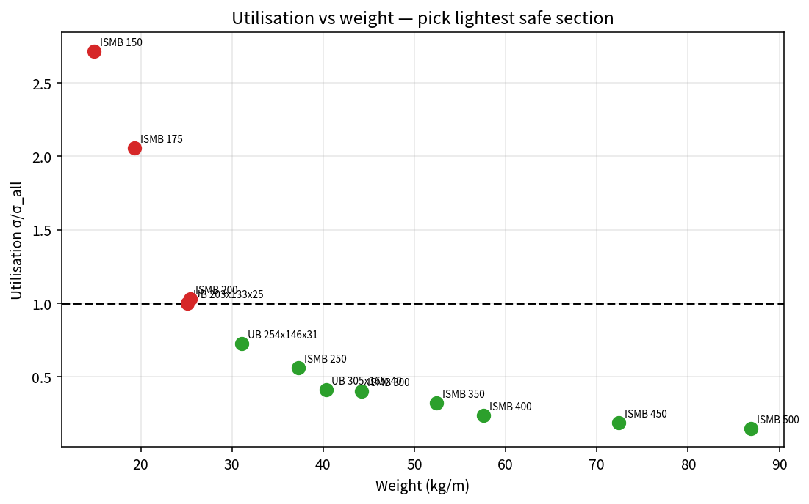

### Auto-recommend summary
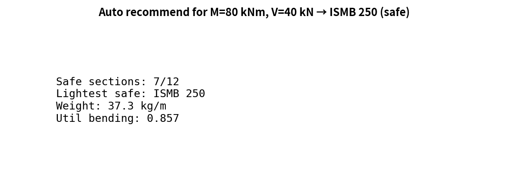

### Section capacity chart
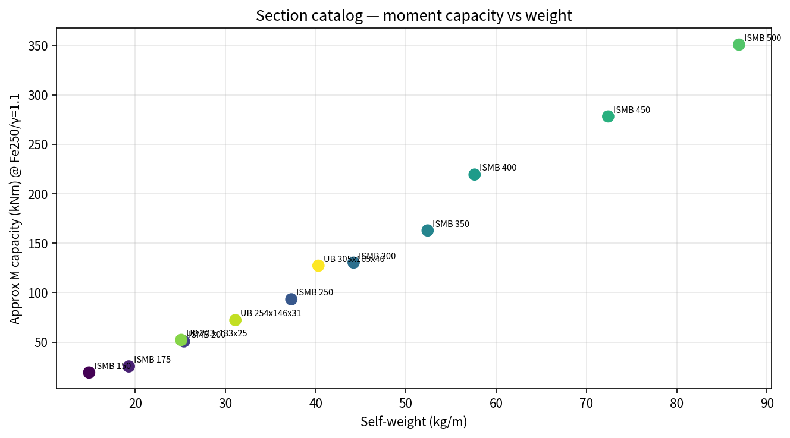

### Deflection by section
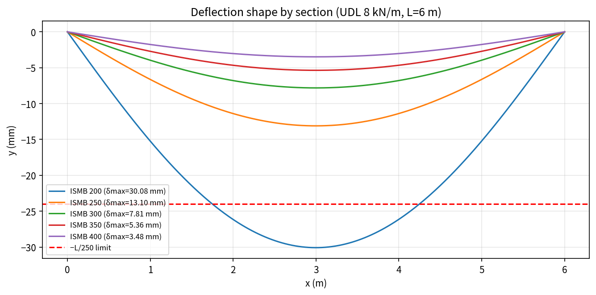

### Serviceability
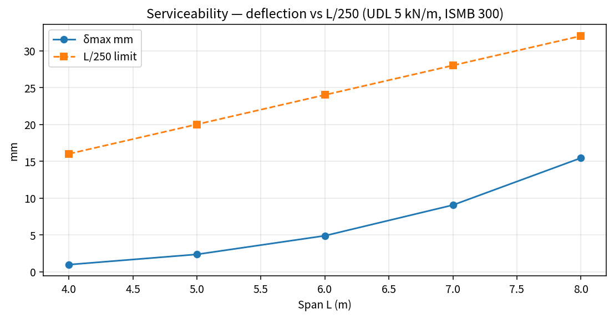

### Moment heatmap (L × w)
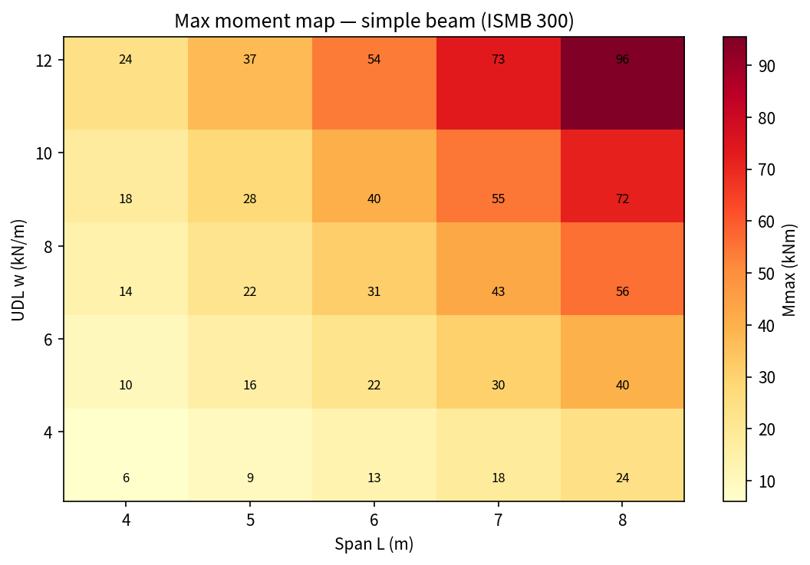

### Before / after auto-select
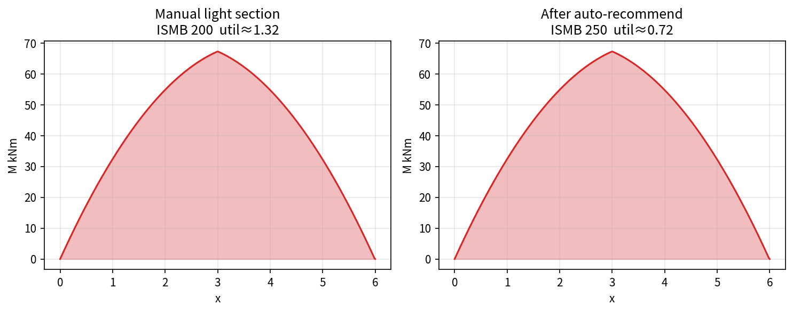

### 3D schematic
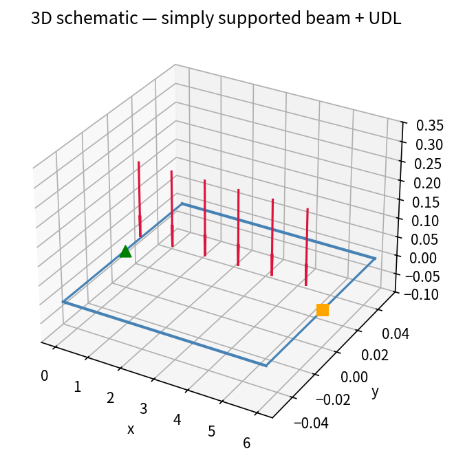

### Response vs UDL
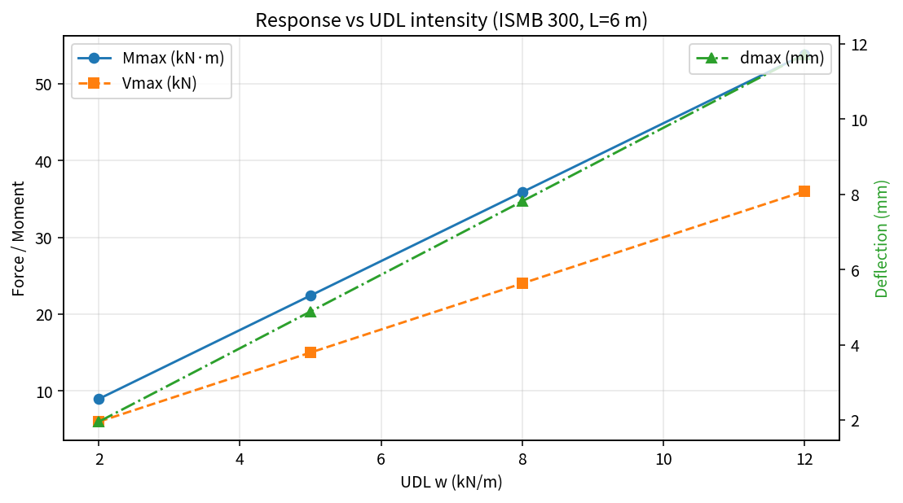

### Load schematic
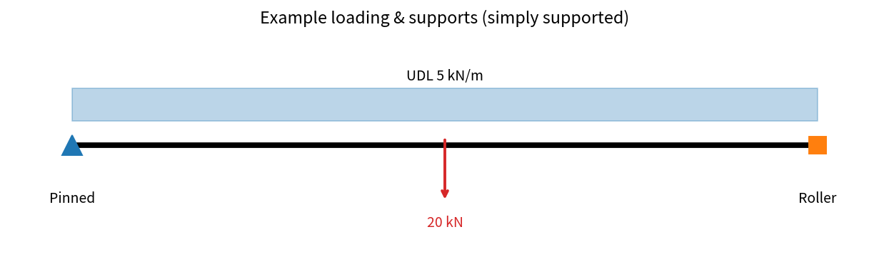

## Modules

| File | Role |
|------|------|
| `beam_solver.py` | V, M, δ, serviceability, parametric |
| `steel_sections.py` | Catalog, checks, recommend |
| `app_streamlit.py` | Dashboard |
| `test_beam.py` | 5 analytical / unit tests |

## Layout (completely flat — no sub-folders)

```
.
├── README.md  LICENSE  requirements.txt  .gitignore
├── beam_solver.py  steel_sections.py  app_streamlit.py  test_beam.py
└── 17 PNG diagrams (design_workflow.png, sfd_bmd_deflection.png, ...)
```

## Notes

Educational portfolio tool. Simplified checks — not a full IS 800 / AISC design package.

**Tags:** `beam-design` `sfd` `bmd` `steel` `streamlit` `mechanical-engineering`


## License

MIT — see [LICENSE](LICENSE).
